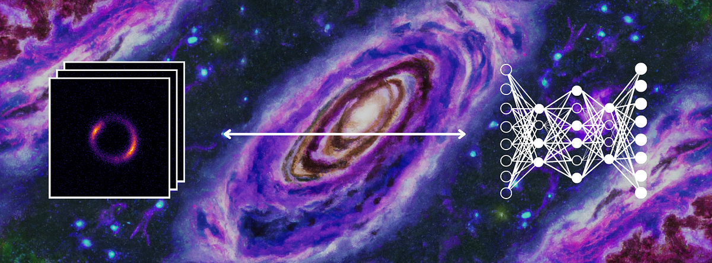
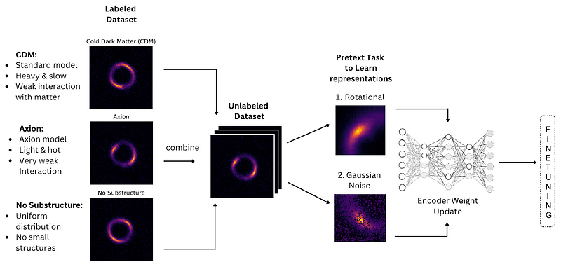
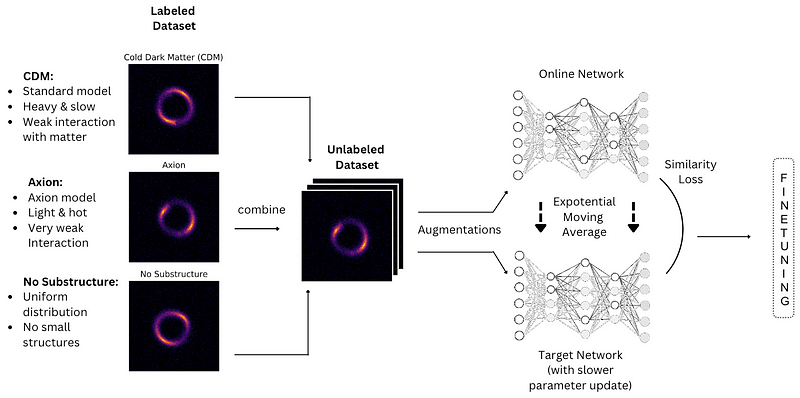

# Self-Supervised Learning for Strong Gravitational Lensing  :sparkles: :milky_way:
*Special thanks to (mentors) Anna Parul, Yurii Halychanskyi, and Sergei Gleyzer.*
<hr>

Click on this button below to read the detailed blog (Part 1): <br><br> [](https://yaashwardhan.medium.com/self-supervised-learning-for-strong-gravitational-lensing-part1-5a049e976b51)



Code is written in: <br>[](https://skillicons.dev)

---

## Project Overview

This module implements **self-supervised learning (SSL)** techniques — specifically **Contrastive Learning** (Rotation & Gaussian Noise pretext tasks) and **Bootstrap Your Own Latent (BYOL)** — for classifying strong gravitational lensing images from [DeepLense](https://github.com/ML4SCI/DeepLense) datasets.

**Key goals:**
- Pre-train a ResNet50 encoder on unlabelled lensing images using SSL pretext tasks.
- Fine-tune the pre-trained encoder on labelled data for downstream classification (axion / CDM / no sub-structure).
- Benchmark SSL performance against a fully supervised ResNet50 baseline.

The pipeline covers:
1. Data loading and augmentation
2. Self-supervised pre-training (BYOL / Contrastive Learning)
3. Fine-tuning on labelled data
4. Evaluation (AUC, ROC curves, confusion matrix)

---

## Installation

### Prerequisites
- Python ≥ 3.8
- CUDA-compatible GPU (recommended for training)

### 1. Clone the repository

```bash
git clone https://github.com/ML4SCI/DeepLense.git
cd DeepLense
```

### 2. (Optional) Create a virtual environment

```bash
python -m venv venv
# On Linux/macOS
source venv/bin/activate
# On Windows
venv\Scripts\activate
```

### 3. Install dependencies

```bash
pip install tensorflow>=2.6 keras numpy pandas scikit-learn pillow imageio tqdm matplotlib
```

> **Note:** TensorFlow ≥ 2.6 is required. If you have a GPU, install the GPU-enabled build:
> ```bash
> pip install tensorflow-gpu>=2.6
> ```

---

## Repository Structure

```
Deeplens_Self_Supervised_Learning_Yashwardhan_Deshmukh/
│
├── byol_learning/                  # BYOL self-supervised pipeline
│   ├── 1.imports.py                # All imports
│   ├── 2.parameters.py             # Hyperparameters (image size, epochs, lr, batch size)
│   ├── 3.augmentation.py           # Data augmentation strategies
│   ├── 4.data_generator.py         # Custom Keras data generator
│   ├── 5.encoder.py                # Encoder/projection head definition
│   ├── 6.resnet50_baseline.py      # Supervised ResNet50 baseline
│   ├── 7.byol_pretraining.py       # BYOL pre-training loop
│   ├── 8.finetuning.py             # Fine-tuning on labelled data
│   ├── 9.eval.py                   # Evaluation: AUC, ROC, confusion matrix
│   └── notebooks/                  # Jupyter notebooks for exploration
│
├── contrastive_learning/           # Contrastive Learning pipeline
│   ├── 1.imports.py
│   ├── 2.parameters.py
│   ├── 3.data_generator.py
│   ├── 4.augmentations.py          # Rotation & Gaussian Noise augmentations
│   ├── 5.encoder.py
│   ├── 5.vit_encoder.py            # Vision Transformer encoder (experimental)
│   ├── 6.resnet50_baseline.py
│   ├── 7.rotation_pretraining.py   # Contrastive pre-training (Rotation pretext)
│   ├── 8.rotation_finetuning.py
│   ├── 9.gaussian_pretraining.py   # Contrastive pre-training (Gaussian Noise pretext)
│   ├── 10.gaussian_finetuning.py
│   ├── 11.eval.py
│   └── notebooks/
│
├── real_data/                      # Scripts tested on real observational data
├── regression_notebooks/           # Regression experiments with SSL representations
│
├── header.png
├── byol.png
├── contrastive.png
├── augmentations.png
└── README.md
```

---

## Usage

Each numbered Python script is designed to be run **in order** within its respective folder. Below are the steps for each pipeline.

### BYOL Pipeline

```bash
cd byol_learning

# Step 1 – (Optional) Review/adjust imports
python 1.imports.py

# Step 2 – (Optional) Adjust hyperparameters
# Edit 2.parameters.py: width, num_epochs, batch_size, lr, input_shape

# Step 3 – Pre-train the encoder using BYOL
python 7.byol_pretraining.py

# Step 4 – Fine-tune on labelled data
python 8.finetuning.py

# Step 5 – Evaluate the model
python 9.eval.py
```

### Contrastive Learning Pipeline (Rotation Pretext)

```bash
cd contrastive_learning

# Pre-train with rotation pretext task
python 7.rotation_pretraining.py

# Fine-tune
python 8.rotation_finetuning.py

# Evaluate
python 11.eval.py
```

### Contrastive Learning Pipeline (Gaussian Noise Pretext)

```bash
cd contrastive_learning

# Pre-train with Gaussian noise pretext task
python 9.gaussian_pretraining.py

# Fine-tune
python 10.gaussian_finetuning.py

# Evaluate
python 11.eval.py
```

### Key Hyperparameters (`2.parameters.py`)

| Parameter     | Default | Description                        |
|:-------------:|:-------:|:----------------------------------:|
| `width`       | 128     | Width of the projection head       |
| `num_epochs`  | 30      | Number of training epochs          |
| `batch_size`  | 128     | Batch size                         |
| `lr`          | 1e-4    | Learning rate (Adam optimizer)     |
| `input_shape` | (64,64,3) | Input image shape               |

---

## Contrastive Learning

Contrastive learning is a type of self-supervised learning method that learns similar and dissimilar representations by contrasting positive and negative examples.



## Bootstrap Your Own Latent (BYOL) Learning

BYOL trains two networks — an **online network** and a **target network** — in parallel. Unlike contrastive learning, there are no negative pairs. Two augmented views of the same image are passed through both networks; the online network is trained to predict the target network's representation, while the target network is updated as a moving average of the online network.



---

## Classification Results

The values in the Model columns represent AUC for axion, cdm and no_sub respectively.  
e.g. `(0.97, 0.96, 1.0)` → 0.97 AUC for axion, 0.96 AUC for cdm, 1.0 AUC for no_sub.

All results were calculated on a **separate test set**.

|            NN Architecture            |    Model I     |  Model II   |  Model III   |
| :-----------------------------------: | :------------: | :---------: | :----------: |
|   Baseline ResNet50      | 0.97, 0.96, 1.0 |   0.98, 0.92, 0.98   |    0.96,0.95,0.99    |
|  Contrastive Learning Rotation Pretext | 0.92, 0.91, 1.0 |**0.99, 0.99, 1.0** | **1.0, 0.99, 1.0** |
|Contrastive Learning Gaussian Noise Pretext| 0.96,0.95,1.0   | **0.99, 0.99, 1.0**     |   **1.0, 0.99, 1.0**    |
| Bootstrap Your Own Latent | 0.95, 0.93, 1.0 |    **1.0, 0.98, 1.0**  |   0.98, 0.92, 0.98   |

---

## Conclusion and Future Goals

Self-supervised learning results are consistently **superior** to the supervised ResNet50 baseline across all three models.

Future goals:
- Test SSL representations for regression tasks
- Implement Vision Transformer (ViT) twin networks for SSL
- Explore additional SSL methods (SimSiam, MoCo, etc.)
- Evaluate on real observational lensing data
