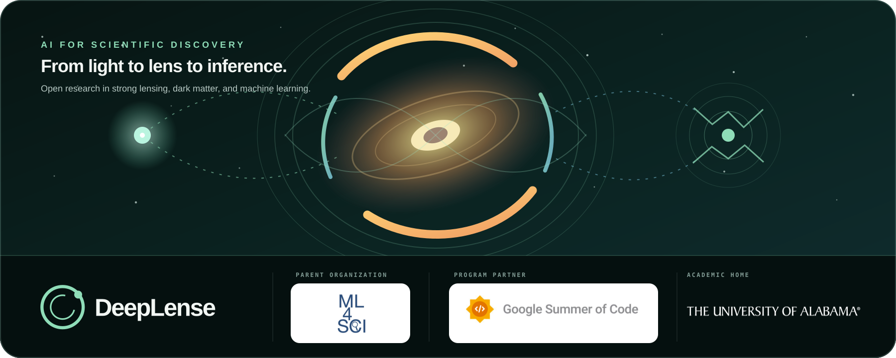

<p align="center">
  
</p>

<p align="center">
  <strong>Open research in machine learning, physics, and astronomy.</strong><br>
  Studying dark matter with strong gravitational lenses and building machine-learning methods for scientific data.
</p>

<p align="center">
  <a href="https://deeplense.org/">Website</a> ·
  <a href="https://deeplense.org/research">Publications</a> ·
  <a href="https://deeplense.org/software">Software</a> ·
  <a href="https://ml4sci.org/">ML4SCI</a> ·
  <a href="mailto:ml4-sci@cern.ch">Contact</a>
</p>

---

## About DeepLense

DeepLense is an open-source research group within [Machine Learning for Science (ML4SCI)](https://ml4sci.org/). We use strong gravitational lensing to study dark-matter structure and develop methods for problems that recur across scientific machine learning: limited labels, domain shift, physical constraints, generative simulation, inverse problems, and automated experimentation.

A foreground galaxy bends light from a more distant source into arcs and rings. Small structures in the lens can leave subtle signatures in those images. DeepLense connects controlled simulations, astronomical survey data, and task-aware machine learning to ask what information can be recovered reliably.

> [!IMPORTANT]
> This repository is a collection of independent research artifacts, not a single installable Python package. Each top-level project has its own data assumptions, environment, and reproduction instructions. Start with the README inside the project you want to use.

## Start here

| I want to… | Go to… |
|---|---|
| Understand the research program | [DeepLense research](https://deeplense.org/research) |
| Find code for a particular experiment | [Project index](#project-index) |
| Generate controlled lensing simulations | [DeepLenseSim](https://github.com/mwt5345/DeepLenseSim) |
| Work with real source morphology | [DeepLense RealSky](https://github.com/lparis3/deeplens_update) |
| Prepare Rubin Observatory data | [RIPPLe](DeepLense_Data_Processing_Pipeline_for_the_LSST/) |
| Explore scientific-agent workflows | [DeepLense AI Scientist](https://github.com/ML4SCI/DeepLense-AI-Scientist) |
| Discuss a research idea or contribution | Email [ml4-sci@cern.ch](mailto:ml4-sci@cern.ch) |

## Research map

| Area | Questions we study | Representative projects |
|---|---|---|
| Dark-matter inference | Can lens morphology distinguish substructure models or recover physical parameters? | Classification, regression, anomaly detection |
| Representations and symmetries | Which invariances help a scientific task, and which remove useful information? | Self-supervision, JEPA models, equivariant networks |
| Simulation and inverse problems | Can learned generators accelerate simulation without hiding physical failure modes? | Diffusion, flow matching, super-resolution |
| Simulation-to-survey transfer | How do models trained on controlled data behave on real or survey-like observations? | Domain adaptation, real-lens finding, Rubin pipelines |
| Scientific systems | Can structured tools support reproducible model search, field surrogates, and experiment planning? | Neural operators, typed agents, automated evaluation |

### Selected current work

- **Lens-LeJEPA** studies task-aware invariances for label-efficient strong-lens representations. [Open the project](DeepLense_Gravitational_FM_Arnesh_Batra/)
- **RIPPLe** connects Rubin Observatory data products to DeepLense preprocessing and inference workflows. [Open the project](DeepLense_Data_Processing_Pipeline_for_the_LSST/)
- **Neural operators for lensing and PDEs** compare operator architectures across lensing, Darcy flow, and Navier–Stokes benchmarks. [Open the project](Neural_operators_for_lensing_and_pde_benchmarks/)
- **DLens / DeepLense AI Scientist** coordinates simulation, architecture search, evaluation, and experiment planning through typed agents. [Open the companion repository](https://github.com/ML4SCI/DeepLense-AI-Scientist)
- **FlowLensing and generative simulation** explore fast conditional generation across physical parameters and dark-matter classes. [Browse the publication record](https://deeplense.org/research)

## Using this repository

The full history and research outputs make this a large repository. Clone everything when you need to compare multiple projects:

```bash
git clone https://github.com/ML4SCI/DeepLense.git
cd DeepLense
```

For one project, a sparse checkout is usually faster:

```bash
git clone --filter=blob:none --sparse https://github.com/ML4SCI/DeepLense.git
cd DeepLense
git sparse-checkout set DeepLense_Gravitational_FM_Arnesh_Batra
```

Then follow that directory's README. There is intentionally no root-level `requirements.txt`: environments from different studies may require different Python, CUDA, PyTorch, or astronomy-stack versions.

> [!NOTE]
> Trained weights and datasets are not uniformly stored in Git. A project README may point to an external dataset, checkpoint, or companion repository. Reproduction claims should be interpreted with the paper's data split, seeds, metrics, and hardware assumptions.

## Project index

Project names below follow the title recorded in each artifact's README. Where a folder directly underpins a named publication, the formal paper title is used.

### Representation learning, classification, and inference

| Project | Contributor | Focus |
|---|---|---|
| [DeepLense Classification Using Vision Transformers](DeepLense_Classification_Transformers_Archil_Srivastava/) | Archil Srivastava · [@archilk](https://github.com/archilk) | Transformer families for dark-matter substructure classification |
| [Unsupervised Domain Adaptation for Gravitational Lens Finding](DeepLense_Gravitational_Lensing_Mriganka_Nath/) | Mriganka Nath · [@mrinath123](https://github.com/mrinath123) | Adapting lens finders from simulated to observed lensing images |
| [Lens-LeJEPA](DeepLense_Gravitational_FM_Arnesh_Batra/) | Arnesh Batra · [@arnesh2212](https://github.com/arnesh2212) | Physics-aware joint-embedding learning and task-dependent invariances |
| [LensID: Gravitational Lens Finding and Classification](DeepLense_Gravitational_Lens_Classification_Transformers_Dhruv_Srivastava/) | Dhruv Srivastava · [@suki-yaki-7](https://github.com/suki-yaki-7) | Lens finding and dark-matter classification with CNNs and Transformers |
| [LensPINN: Physics-Informed Neural Network for Learning Dark Matter Morphology in Lensing](DeepLense_Physics_Informed_Neural_Network_for_Dark_Matter_Morphology_Ashutosh_Ojha/) | Ashutosh Ojha · [@ghatotkachhh](https://github.com/ghatotkachhh) | Physics-guided encoders, source reconstruction, and morphology classification |
| [Learning Representation Through Self-Supervised Learning on Real Gravitational Lensing Images](DeepLense_SSL_from_real_dataset_Sreehari_Iyer/) | Sreehari Iyer · [@iyersreehari](https://github.com/iyersreehari) | SimSiam, DINO, and iBOT on real-lensing imagery |
| [Self-Supervised Learning for Strong Gravitational Lensing](Deeplens_Self_Supervised_Learning_Yashwardhan_Deshmukh/) | Yashwardhan Deshmukh · [@yaashwardhan](https://github.com/yaashwardhan) | Contrastive learning and BYOL on simulated lensing data |
| [Domain Adaptation for Simulation-Based Dark Matter Searches Using Strong Gravitational Lensing](Domain_Adaptation_for_DeepLense_Marcos_Tidball/) | Marcos Tidball · [@zysymu](https://github.com/zysymu) | ADDA, self-ensembling, and related transfer methods |
| [Equivariant Neural Networks for Dark Matter Morphology with Strong Gravitational Lensing](Equivariant_Neural_Networks_for_DeepLense_Apoorva_Singh/) | Apoorva Singh · [@Apoorva99](https://github.com/Apoorva99) | Rotation-aware models for dark-matter morphology |
| [Equivariant Neural Networks for Dark Matter Morphology with Strong Gravitational Lensing](Equivariant_Neural_Networks_for_DeepLense_GEO/) | Geo Jolly · [@kingjuno](https://github.com/kingjuno) | Rotation- and reflection-aware lens classifiers |
| [Lensiformer: A Relativistic Physics-Informed Vision Transformer Architecture for Dark Matter Morphology in Gravitational Lensing](Physics_Informed_Transformers_For_Dark-Matter_Morphology_Lucas_Jose/) | Lucas José Velôso de Souza · [@lucasjvds](https://github.com/lucasjvds) | Lens-potential modeling, source reconstruction, and morphology classification |
| [DeepLense Classification: Self-Supervised & Supervised Learning](Transformers_Classification_DeepLense_Kartik_Sachdev/) | Kartik Sachdev · [@sachdevkartik](https://github.com/sachdevkartik) | Transformer benchmarking across learning regimes |
| [Updating the DeepLense Pipeline](Updating_the_DeepLense_Pipeline__Saranga_K_Mahanta/) | Saranga K. Mahanta · [@Saranga7](https://github.com/Saranga7) | Classification, anomaly detection, and regression benchmarks |
| [DeepLense Regression](DeepLense_Regression_Yurii_Halychanskyi/) | Yurii Halychanskyi · [@Claussss](https://github.com/Claussss) | Regression of axion mass density from simulated lensing images |
| [GSoC 2022 Deep Regression](DeepLense_Regression_Zhongchao_Guan/) | Zhongchao Guan · [@AllenWrong](https://github.com/AllenWrong) | ResNet, ViT, and CNN-Transformer regression experiments |

### Simulation, generation, and super-resolution

| Project | Contributor | Focus |
|---|---|---|
| [Diffusion Model for Gravitational Lensing Simulation](DeepLense_Diffusion_Hamees/) | Hamees Sayed · [@hamees-sayed](https://github.com/hamees-sayed) | Learned generation and evaluation of lensing images |
| [Diffusion Models for Gravitational Lensing Simulation](DeepLense_Diffusion_Rishi/) | J Rishi · [@RishiPurna2000](https://github.com/RishiPurna2000) | Class- and parameter-conditioned lens generation |
| [From Simulation to Survey: Benchmarking Super-Resolution for LSST-like Lensing Data](Difflense_Aleksandr_Duplinskii/) | Alexander Duplinskii · [@aduplins](https://github.com/aduplins) | Mejiro-based benchmark generation and comparison of diffusion and baseline super-resolution methods |
| [Physics-Informed Unsupervised Super-Resolution of Strong Lensing Images](DeepLense_Physics_Informed_Super_Resolution_Anirudh_Shankar/) | Anirudh Shankar · [@anirudhshankar99](https://github.com/anirudhshankar99) | Super-resolution without paired high-resolution targets |
| [Grid-Based Strong Gravitational Lensing for Unsupervised Super-Resolution](Grid_based_strong_lensing_for_unsupervised_super_resolution_Anirudh_Shankar/) | Anirudh Shankar · [@anirudhshankar99](https://github.com/anirudhshankar99) | Fast differentiable lensing operators for unsupervised reconstruction |
| [Single Image Super-Resolution with Diffusion Models](Super_Resolution_Atal_Gupta/) | Atal Gupta · [@AtalGupta](https://github.com/AtalGupta) | Diffusion models for enhancing gravitational-lensing images |
| [DiffLense: A Conditional Diffusion Model for Super-Resolution of Gravitational Lensing Data](Super_Resolution_Pranath_Reddy/) | Pranath Reddy · [@pranath-reddy](https://github.com/pranath-reddy) | Residual baselines and conditional-diffusion super-resolution |

### Data systems, operators, and scientific agents

| Project | Contributor | Focus |
|---|---|---|
| [RIPPLe: Rubin Image Preparation and Processing Lensing Engine](DeepLense_Data_Processing_Pipeline_for_the_LSST/) | Karthik Mandar · [@kartikmandar](https://github.com/kartikmandar) | Rubin LSST data access, preprocessing, and model interfaces |
| [Neural Operators for Lensing and PDE Benchmarks](Neural_operators_for_lensing_and_pde_benchmarks/) | Paras Balani · [@Metrex-Nova](https://github.com/Metrex-Nova) | Resolution transfer and operator-learning benchmarks |
| [DeepLense AI Scientist](DeepLense_AI_Scientist_Aatmaj_Amol_Salunke/) | Aatmaj Amol Salunke · [@aatmaj28](https://github.com/aatmaj28) | Closed-loop architecture search and simulation code-generation agents |

## Dataset vocabulary

Several historical projects use the same model names for simulated datasets. Treat this table as orientation; the project README and associated paper define the authoritative preprocessing and split.

| Dataset | Typical configuration | Common use |
|---|---|---|
| Model I | Synthetic lens and source profiles with controlled noise and dark-matter classes | Baselines and representation pretraining |
| Model II | Euclid-like observing characteristics | Classification, regression, and transfer studies |
| Model III | HST-like observing characteristics | Cross-instrument evaluation and downstream tasks |
| Model IV | Real galaxy source morphology in a multichannel lensing setup | Realistic simulation and representation learning |

The early datasets were generated with [DeepLenseSim](https://github.com/mwt5345/DeepLenseSim), built around `lenstronomy`, `pyHalo`, and `Colossus`. Newer projects may use different simulators, survey products, or task-specific datasets.

## Related software

| Repository | Role |
|---|---|
| [DeepLenseSim](https://github.com/mwt5345/DeepLenseSim) | Foundational synthetic lensing and dataset generation |
| [DeepLense RealSky](https://github.com/lparis3/deeplens_update) | Simulation with real galaxy source images and sampled physical parameters |
| [RIPPLe](https://github.com/kartikmandar/RIPPLe) | Rubin Image Preparation and Processing Lensing Engine |
| [RIPPLe Scientist](https://github.com/pranath-reddy/genesis-ripple) | Experimental agent-based Rubin data workflow |
| [DeepLense AI Scientist](https://github.com/ML4SCI/DeepLense-AI-Scientist) | Closed-loop model search and simulation agents |

See [deeplense.org/software](https://deeplense.org/software) for the software map and intended use of each repository.

## Reproducibility and interpretation

Most quantitative results in this repository come from bounded experimental settings, often with simulated or survey-like data. A high benchmark score is not, by itself, a claim of equivalent performance on the sky. When comparing results, check:

- the simulation and observing assumptions;
- train, validation, and test construction;
- random seeds and model-selection procedure;
- whether the task is classification, reconstruction, regression, or physical inference;
- whether generated detail is supported by recorded information;
- whether adaptation uses a representative target sample.

The associated publication is the source of record for a result. Browse the [DeepLense publication list](https://deeplense.org/research) for papers, venues, and available preprints.

## Contributing and collaboration

Most folders contain code released with a specific paper or mentored research project. They are maintained as research artifacts rather than general-purpose community packages.

If you have a research idea or would like to contribute, email [ml4-sci@cern.ch](mailto:ml4-sci@cern.ch) **before opening a pull request**. Include:

1. the scientific question or idea;
2. the project directory or research area it relates to;
3. your relevant background;
4. the contribution you would like to make.

For a reproducibility problem in existing code, open a focused issue with the project path, commit hash, environment, minimal command, and complete error message. Please do not open broad cleanup or feature pull requests without first coordinating with the project authors.

### Pull requests to a research artifact

Every project in the [project index](#project-index) lists its original contributor and GitHub handle. If you have coordinated a change and are opening a pull request, you must:

1. name the exact project directory in the PR title or description;
2. tag the contributor listed for that project using their `@handle`;
3. explain what was changed, why it is relevant to that research artifact, and how it was tested.

Do not tag the entire group or an unrelated contributor. The listed contributor provides project-specific context; repository maintainers still make the final review and merge decision. If the contributor is unavailable, email [ml4-sci@cern.ch](mailto:ml4-sci@cern.ch) so the group can identify an appropriate reviewer.

## Citation and licensing

If you use a project, dataset, or model, cite the paper associated with that directory. The founding DeepLense study is [*Deep Learning the Morphology of Dark Matter Substructure*](https://doi.org/10.3847/1538-4357/ab7925); later projects have their own papers and citation requirements.

Licensing varies across subprojects. Check the license file inside the relevant directory and the terms of any external data or model weights before reuse. The absence of a root-level license does not grant permission to reuse every artifact under a single license.

## Acknowledgements

DeepLense is part of [ML4SCI](https://ml4sci.org/) and has grown through long-term research collaboration, Google Summer of Code mentorship, and support from participating institutions and funding programs. Project-specific acknowledgements and contributor credits are preserved in each directory.
